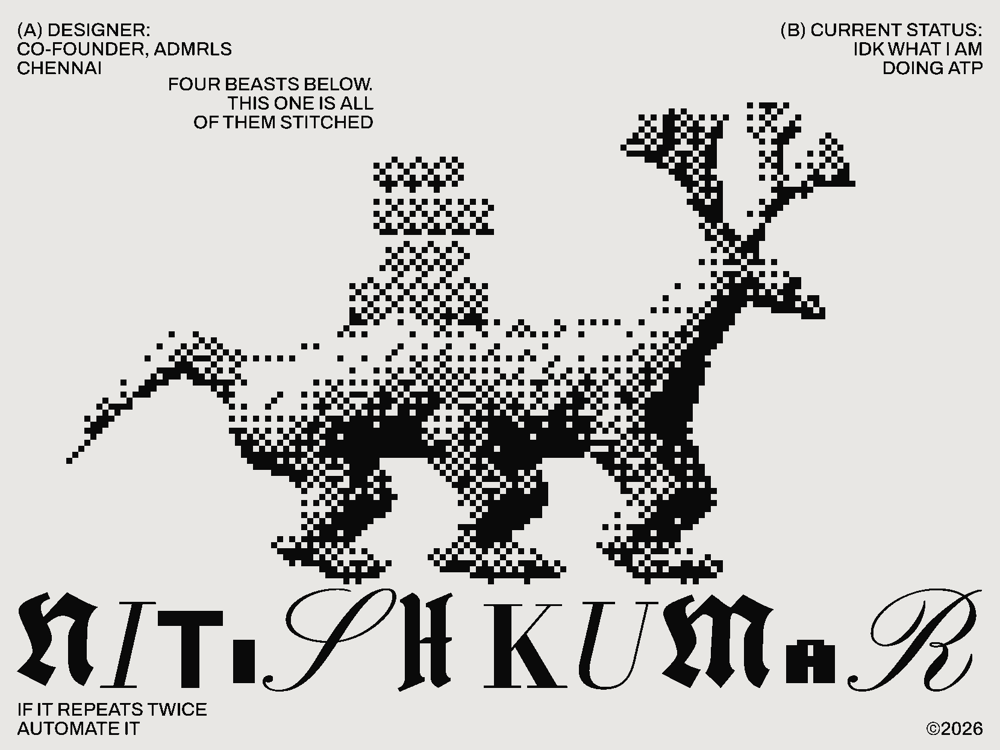
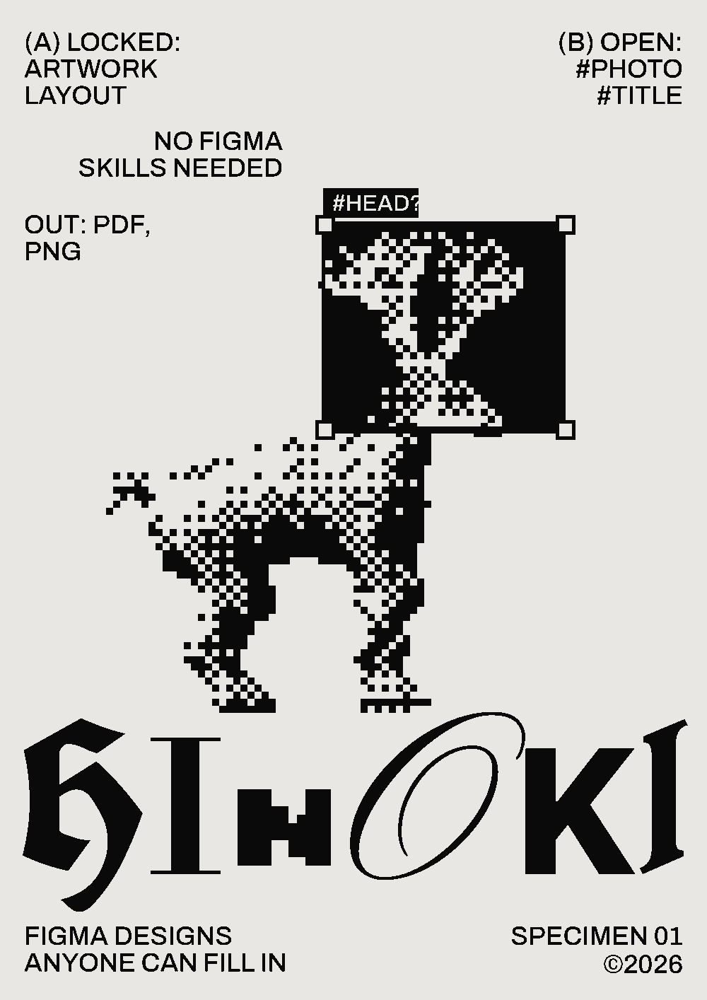
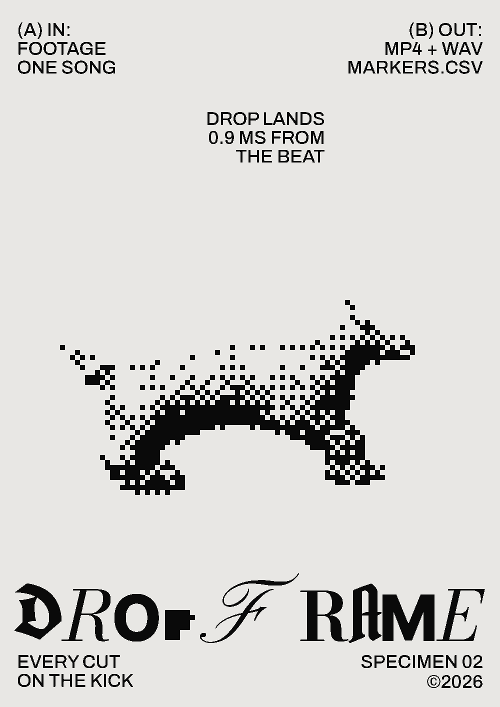
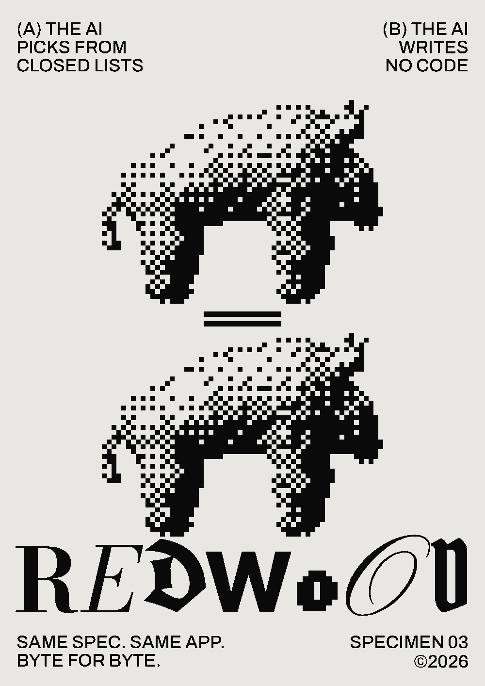
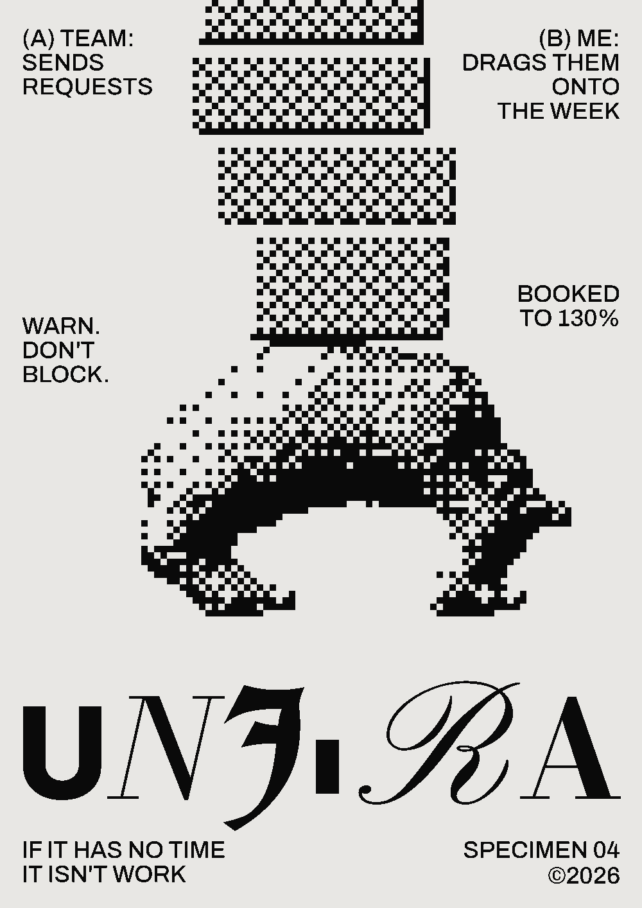
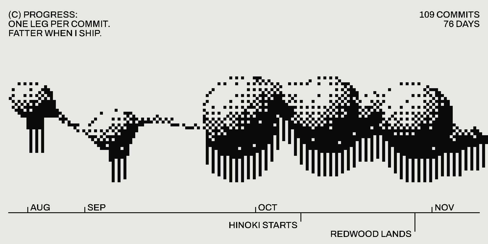
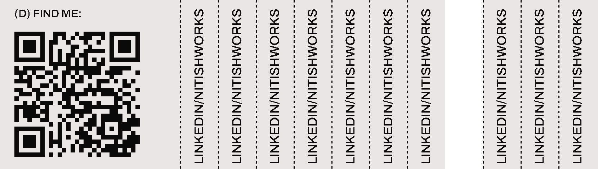

<a href="https://www.admrls.com"><picture><source media="(prefers-reduced-motion: reduce)" srcset="./assets/hero.png"></picture></a> 
 <a href="https://github.com/Zerko-sd/dropframe"><picture><source media="(prefers-reduced-motion: reduce)" srcset="./assets/dropframe.png"></picture></a> 
  
 

